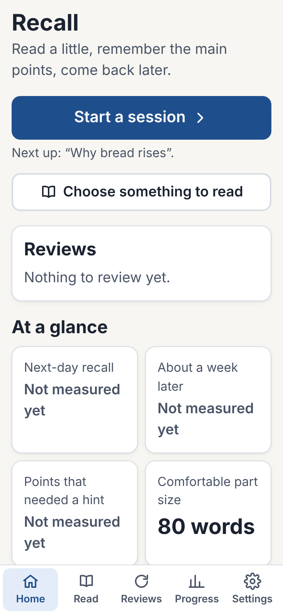
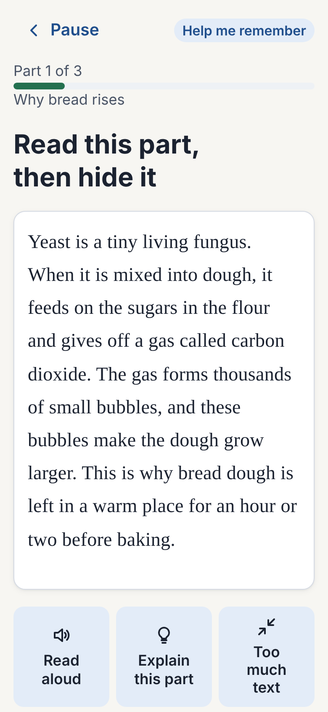
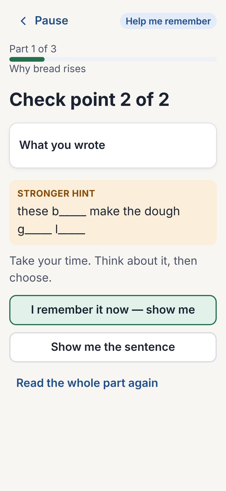
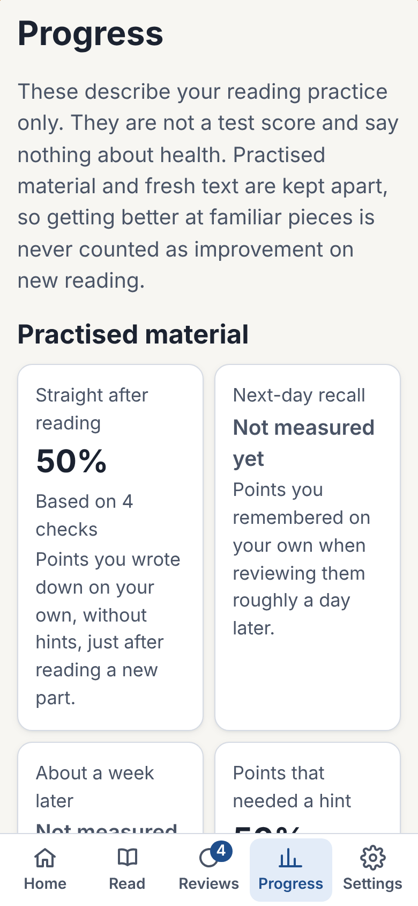

# Recall (Read & Remember)

A calm, private reading aid for adults: **read a small part → hide it → write what you remember in your own words → check against the source-backed main points, with the least help needed → see the points again on a later day.** Recall also separates progress on practised material from first reads of fresh text.

No account, no tracking, no AI, no internet needed after the first load. Not a medical or diagnostic tool.

| | Status |
|---|---|
| Web app (installable PWA, offline) | Built and tested in Chromium at iPhone sizes → **BUILT_NOT_DEPLOYED** (needs an https host, see `docs/DEPLOYMENT.md`) |
| Physical iPhone | **PHYSICAL_IPHONE_NOT_TESTED** — 10-minute checklist in `docs/IPHONE-INSTALL-AND-TEST.md` |
| Native iOS app (Expo/EAS) | Prepared; signing **IOS_SIGNING_BLOCKED_EXTERNAL** (Apple Developer + Expo accounts). See `docs/RELEASE-REPORT.md` |
| Automatic answer marking | **EXPERIMENTAL/DISABLED** — the candidate scorer failed the A001 gate; the app uses self-check + objective questions |
| Adaptive (FSRS-style) scheduler | **Shadow mode only**; real review dates use transparent fixed steps |

Full evidence: **`docs/RELEASE-REPORT.md`**. Continuing the work: **`CLAUDE.md`** and `docs/EXECUTION-STATE.md`.

## Screens (browser screenshots, Chromium 390×844 — not device screenshots)

| Home | Reading | Self-check with hints | Progress |
|---|---|---|---|
|  |  |  |  |

## Commands (Windows PowerShell, macOS or Linux)

Prerequisites: Node.js 22 LTS. Python 3.11+ is needed only for the A001 harness and the optional API tests.

```bash
npm ci                 # install exactly what the lockfile says
npm run dev            # web app at http://localhost:5173 (development)
npm run build          # production PWA in apps/web/dist
npm run preview        # serve the production build at http://localhost:4173
npm test               # unit tests (core, content, storage, backup, scheduler, IndexedDB)
npm run e2e            # Playwright end-to-end (needs: npx playwright install chromium)
npm run a001           # original A001 harness + candidate scorer, 5 runs × every case
npm run api:test       # optional FastAPI service tests (creates services/api/.venv)
npm run verify         # everything above plus lint, types, format, audit and secret scans
npm run release        # release/recall-pwa-<version>.zip + SHA256SUMS.txt
```

Native app: see `apps/mobile/README.md` (`cd apps/mobile && npm ci && npx expo start`).

## How it works

- **Two modes:** *Help me read this* (text stays visible; read aloud; main points with their exact sentences; an understanding question) and *Help me remember this* (read, hide, recall, check, review later).
- **Parts** are about 80 words to start with (minimum 40, maximum 180) and always end at a meaningful boundary, with 1–2 main ideas (never more than 3). **Too much text** shortens parts straight away. The automatic size changes slowly, at most once per session, based on next-day recall of recent new parts. You can also fix the size yourself.
- **Hints** go from small to big: 1 how many points there are and what one is about → 2 a meaning hint → 3 the sentence with key words missing → 4 the sentence → 5 the whole part. The highest level needed is recorded.
- **Reviews** come back after 1, 3, 7, 14, 30, 60 and 120 days (fixed, transparent steps). An FSRS-style model calculates its own suggestion in the background for later evaluation, but it never changes real review dates.
- **Progress** shows straight-after-reading, next-day and about-a-week recall, hints needed, understanding questions and comfortable part size. Fresh-text checks are a separate set of six passages, reported separately. A measure that hasn’t been measured yet says **Not measured yet**.
- **Your data** stays on the device. Export, import and delete are in Settings.

## Repository layout

See `docs/ARCHITECTURE.md`. In short: `packages/core` (tested domain logic), `packages/content` (passages), `apps/web` (PWA), `apps/mobile` (Expo), `services/api` (optional, disabled-by-default provider service), `tests/a001` (harness integration), `e2e` (Playwright), `spec-source` (original specification, unchanged).

## Licence

Code: MIT (`LICENSE`). Reading passages in `packages/content`: original works, CC BY 4.0 (`packages/content/LICENSE`). The original specification pack in `spec-source/` belongs to its authors and is included unchanged for traceability. The app icon is original.
